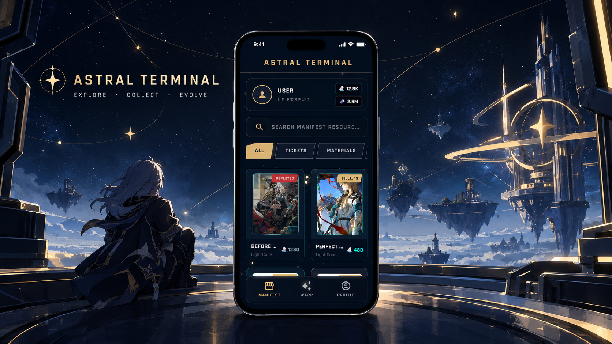

# 🌠 Honkai Star Retail

[](https://flutter.dev/)
[](https://nodejs.org/)
[](https://expressjs.com/)
[](https://www.mysql.com/)



Aplikasi katalog dan sistem pengelolaan *item* bertema **Honkai: Star Rail**. Dilengkapi dengan antarmuka Flutter yang responsif dan backend RESTful API yang aman untuk manajemen autentikasi serta inventaris *resource*.

---

## ✨ Fitur Utama

- 🔐 **Autentikasi Pengguna:** Registrasi dan login aman menggunakan JWT & Firebase Authentication.
- 📦 **Katalog Item & Detail:** Telusuri berbagai *resource* game lengkap dengan informasi detailnya.
- 📊 **Panel Admin & Dashboard:** Pantau statistik data dan kelola *resource* secara *real-time*.
- ⚡ **RESTful API:** Arsitektur backend yang modular dan siap diintegrasikan.

---

## 🛠️ Tech Stack

- **Mobile App:** Flutter, Dart, Firebase Auth, Shared Preferences
- **Backend Server:** Node.js, Express.js, JSON Web Token (JWT)
- **Database:** MySQL

---

## 📁 Struktur Proyek

```text
Honkai_Star_Retail_Project/
├── 📱 honkai_star_retail_app/   # Kode sumber aplikasi Flutter
└── 🖥️ server/                  # REST API & Skema Database MySQL
```

---

## 🚀 Panduan Memulai

### Prasyarat
Sebelum memulai, pastikan Anda sudah menginstal:
- [Flutter SDK](https://docs.flutter.dev/get-started/install)
- [Node.js & npm](https://nodejs.org/)
- [MySQL Server](https://www.mysql.com/)

---

### 1. 🗄️ Konfigurasi Database & Server

1. Import dan jalankan berkas `server/db_schema.sql` pada MySQL Anda.
2. Buat file `.env` di dalam folder `server/` dan sesuaikan nilainya:

```env
PORT=3001
DB_HOST=localhost
DB_USER=root
DB_PASSWORD=password_mysql_kamu
DB_NAME=honkai_star_retail
JWT_SECRET=rahasia_jwt_super_aman
```

> **Catatan Port:** Server menggunakan port `3001` agar selaras dengan konfigurasi bawaan aplikasi Flutter.

3. Jalankan server backend:

```bash
cd server
npm install
npm run dev
```
*(Gunakan `npm start` jika tidak ingin menggunakan nodemon)*

4. **[Opsional] Populate Data Awal:**
```bash
node db_init.js
```
> ⚠️ **Peringatan:** `db_init.js` akan mereset dan menghapus data pada tabel `users` dan `resources`. Gunakan hanya di lingkungan pengembangan!

---

### 2. 📱 Jalankan Aplikasi Flutter

Buka terminal baru di direktori proyek:

```bash
cd honkai_star_retail_app
flutter pub get
flutter run
```

> 💡 **Tip:** Jika menjalankan aplikasi di emulator Android atau perangkat fisik, ubah `localhost` pada file `lib/core/services/api_service.dart` dengan IP lokal komputer Anda (misal: `192.168.x.x`).

---

## 🔌 Endpoint API

Seluruh endpoint dipublikasikan melalui prefix `/api`:

| Method | Endpoint | Deskripsi | Akses |
| :---: | :--- | :--- | :---: |
| `POST` | `/api/auth/register` | Mendaftarkan akun baru | Publik |
| `POST` | `/api/auth/login` | Login & mendapatkan JWT Bearer token | Publik |
| `GET` | `/api/resources` | Menampilkan seluruh katalog *resource* | Publik |
| `GET` | `/api/resources/:id` | Menampilkan detail spesifik *resource* | Publik |
| `POST` | `/api/resources` | Menambahkan *resource* baru | Admin |
| `GET` | `/api/stats` | Mengambil statistik untuk dashboard | Admin |

---

## 🔑 Kredensial Default (Testing)

Jika Anda menjalankan `db_init.js`, gunakan akun bawaan berikut untuk pengujian:

- **Admin:** `admin` / `admin123`
- **User:** `user` / `user123`

---

<p align="center">Made with ❤️ for Trailblazers</p>